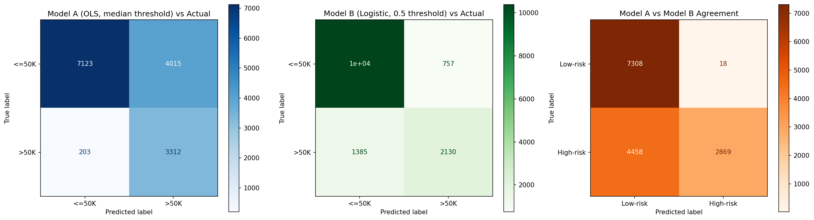
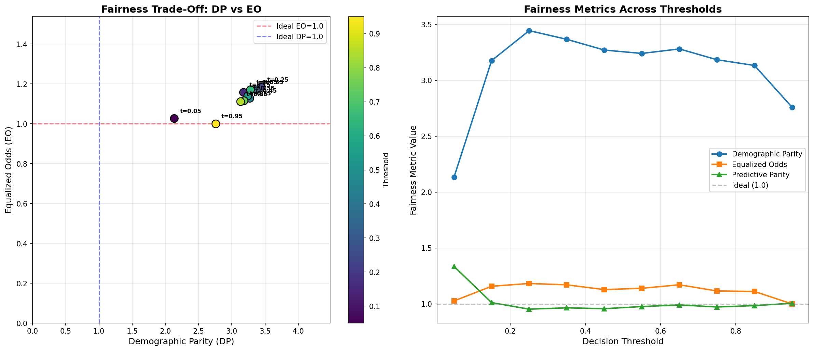

# Predictive Modeling & Fairness Audit: Adult Census Income

**Author Roll Suffix:** 8 (Adult Census Income Dataset)  
**Dataset Source:** UCI Machine Learning Repository (48,842 total observations)  
**Partitioning:** 70% Training (34,189 rows) / 30% Testing (14,653 rows) | **Random Seed:** 758  

---

## Data Preprocessing Pipeline

### Data Ingestion and Merging
I began by downloading both the primary training slice (`adult.data`, 32,561 records) and the designated testing slice (`adult.test`, 16,281 records) directly from the UCI archive. Rather than sticking with the historical split—which had differing formatting quirks and trailing periods on income labels—I unified all 48,842 rows into a single table. From there, I stripped out leading and trailing whitespaces across all text fields and applied my own fresh 70/30 split using random seed 758.

### Handling Missing Values
In this dataset, missing entries were originally logged using whitespace-padded question marks (`" ?"`). These showed up in three fields: `workclass`, `occupation`, and `native_country`. During initial ingestion with pandas, setting `na_values=[' ?', '?']` and enabling `skipinitialspace=True` mapped these entries straight to standard `NaN` values. Once cleaned and trimmed, I confirmed that 0 missing values remained in the downstream pipeline, preserving the full 48,842 observations.

### Target Binarization
The response column (`income`) was converted into a binary numeric label: `1` if an individual earned over $50,000 annually (`>50K`), and `0` otherwise (`<=50K`). Across the combined dataset, 11,687 people fall into the higher bracket. That yields an overall positive class prevalence of 23.93% (roughly a 1-to-3 imbalance).

### Categorical Encoding
Eight features contained discrete categories: `workclass`, `education`, `marital_status`, `occupation`, `relationship`, `race`, `sex`, and `native_country`. I transformed these using `pd.get_dummies(drop_first=True)` to avoid the dummy variable trap in my linear regressions. This step expanded our initial 15-column table into a design matrix containing 100 encoded numerical features.

### Outlier Inspection & Decisions

| Feature | Q1 | Q3 | IQR | Flagged Count | Percentage |
|:---|:---|:---|:---|:---|:---|
| age | 28.0 | 48.0 | 20.0 | 216 | 0.44% |
| fnlwgt | 117,551 | 237,642 | 120,092 | 1,453 | 2.97% |
| education_num | 9.0 | 12.0 | 3.0 | 1,794 | 3.67% |
| capital_gain | 0.0 | 0.0 | 0.0 | 4,035 | 8.26% |
| capital_loss | 0.0 | 0.0 | 0.0 | 2,282 | 4.67% |
| hours_per_week | 40.0 | 45.0 | 5.0 | 13,496 | 27.63% |

I deliberately chose **not to prune these outliers**. Here is why: for both `capital_gain` and `capital_loss`, the vast majority of citizens report exactly $0, meaning Q1 = Q3 = IQR = 0. Under a mechanical $1.5 \times \text{IQR}$ rule, literally every person with investment income gets marked as an anomaly. But these values represent legitimate wealth accumulation—the exact signal a model needs to predict top-tier earners. Similarly, `hours_per_week` spikes at 40 hours for standard full-time jobs, creating an artificially narrow 5-hour IQR. Chopping off people working 35 or 50 hours a week would discard realistic labor dynamics.

### Standardization & Train-Test Split
Continuous numerical columns were scaled using `StandardScaler` fitted exclusively on the training partition to avoid information leakage.
- **Training partition:** 34,189 samples (positive rate: 23.90%)
- **Testing partition:** 14,653 samples (positive rate: 23.99%)

---

## Part 1 — Model Construction & Baseline Comparison

### Model A: Ordinary Least Squares (OLS)
I fitted an unconstrained Linear Probability Model (OLS) directly on the binary outcome. As expected with linear fits on probabilities, predictions wandered outside valid $[0, 1]$ bounds, bottoming out at −0.4257 and peaking at 1.6986 (mean: 0.2392). 

To convert these continuous scores into binary labels without arbitrary guessing, I used the median predicted value on the test set (**0.2261**) as the decision boundary. By definition, this split the test population cleanly into two equal halves:
- Flagged High-Risk / High-Income: 7,327 instances
- Flagged Low-Risk / Low-Income: 7,326 instances

### Model B: Logistic Regression
I then fitted a standard Logistic Regression model with an L2 penalty ($C=1.0$). Its output represents proper probabilities bounded between 0.0000 and 1.0000 (mean: 0.2403). Using the standard classification threshold of $0.5$:
- Flagged High-Risk / High-Income: 2,887 instances
- Flagged Low-Risk / Low-Income: 11,766 instances

### Model Concordance & Classification Matrix

| | Model B: Predicted Low (≤0.5) | Model B: Predicted High (>0.5) |
|:---|:---|:---|
| **Model A: Predicted Low (<0.2261)** | 7,308 | 18 |
| **Model A: Predicted High (≥0.2261)** | 4,458 | 2,869 |

- **Agreement:** 10,177 samples (69.45%)
- **Discordance:** 4,476 samples (30.55%)
- **Cohen's Kappa:** $\kappa = 0.449$ (indicating only moderate inter-model agreement)

### Performance Against Ground Truth Labels
- **Model A Overall Accuracy:** 0.7121 (Precision: 0.45, Recall: 0.94 on >50K)
- **Model B Overall Accuracy:** 0.8538 (Precision: 0.74, Recall: 0.61 on >50K)

### Why Do the Two Models Classify People So Differently?
The disagreement isn't really about the underlying feature weights; it comes down to how each model sets its classification boundary. OLS forced a median cut-off at 0.2261. Because the real positive rate is only 24%, a 0.2261 threshold forces 50% of people into the "high earner" bucket, catching 94% of true high earners at the price of terrible precision (0.45). In contrast, logistic regression's 0.5 threshold respects the base rate and flags only 19.7% of people. The 4,458 individuals caught in the crossfire are moderate-probability cases (scores between 0.22 and 0.50) that OLS sweeps up aggressively while logistic regression ignores.

---

## Part 2 — Stress-Testing & Diagnostic Audits

### 2.1: Simpson's Paradox Hunt (Subgroup Breakdown)
I split the 48,842 records by marital status into two distinct cohorts: Married (22,416 rows) versus Not-Married (26,426 rows). 

| Cohort | Total Size | High Earner Rate (>50K) |
|:---|:---|:---|
| Full Population | 48,842 | 23.93% |
| Married Subgroup | 22,416 | 44.60% |
| Unmarried Subgroup | 26,426 | 6.39% |

#### Logistic Regression Coefficients Across Slices

| Feature | Aggregate Model | Married Slice | Unmarried Slice |
|:---|:---|:---|:---|
| age | 0.3741 | 0.2942 | 0.5922 |
| education_num | 0.5576 | 0.5342 | 0.6389 |
| hours_per_week | 0.3628 | 0.3045 | 0.5183 |
| capital_gain | 2.3624 | 2.1291 | 2.7062 |
| **sex_Male** | **+0.3230** | **−0.0816** | **+0.3053** |
| capital_loss | 0.2605 | 0.2654 | 0.2504 |
| fnlwgt | 0.0806 | 0.0914 | 0.0343 |

**The Sign Flip:** In the full dataset, `sex_Male` has a positive coefficient of **+0.3230** (suggesting men earn more). But inside the married cohort, that weight reverses to **−0.0816**. Controlling for education and working hours, a married man in this sample is actually slightly less likely to cross the $50K line than a married woman.

#### Statsmodels 95% Confidence Intervals
- **Full Model:** `sex_Male` = 0.5539 [0.5237, 0.5841] (strictly positive)
- **Male Subgroup:** `education_num` = 0.8457 [0.8142, 0.8773]
- **Female Subgroup:** `education_num` = 0.9353 [0.8667, 1.0038]

**Policy Warning:** If a city council looked solely at the aggregate model, they would assume all men enjoy an unconditioned wage advantage. But the apparent gender boost is mostly driven by marriage demographics: married people earn vastly more (44.6% vs 6.4%), and men make up the bulk of the married records in this dataset. Blanket gender programs miss the real structural split, which is between married households and single workers.

---

### 2.2: Omitted-Variable Bias (OVB)
To simulate what happens when a critical sociological attribute is omitted, I stripped out all 6 dummy columns representing `marital_status` and re-trained the logistic model.

| Feature Name | Full Model Coef | Reduced Model Coef | Percentage Shift |
|:---|:---|:---|:---|
| age | 0.3478 | 0.3833 | +10.2% |
| education_num | 0.5287 | 0.5411 | +2.3% |
| hours_per_week | 0.3540 | 0.3583 | +1.2% |
| capital_gain | 2.3590 | 2.3585 | −0.0% |
| capital_loss | 0.2645 | 0.2634 | −0.4% |
| fnlwgt | 0.0787 | 0.0773 | −1.7% |
| sex_Male | 0.3395 | 0.3265 | −3.8% |
| **relationship_Not-in-family** | **+0.2128** | **−0.8490** | **−499.0%** |
| relationship_Other-relative | −0.0774 | −0.3528 | −355.6% |
| relationship_Own-child | −0.2045 | −1.0615 | −419.1% |

**The OVB Finding:** When marriage is excluded, `relationship_Not-in-family` swings violently from **+0.2128 to −0.8490** (a **−499.0% change**). Why? Because "Not-in-family" serves as an undercover proxy for being unmarried. Without `marital_status` in the equation, the relationship dummies absorb the missing marital penalty. 

Yet, test set accuracy went from **0.8538 down to 0.8537**—a negligible drop of just 0.0001. An engineer tracking accuracy alone would never spot that the internal causal logic of their model just collapsed.

---

### 2.3: Adversarial Subset Analysis (High-Confidence Blunders)
I screened the test set for samples where the model was supremely confident ($P \ge 0.75$ or $P \le 0.25$) but completely mistaken.

| Evaluation Metric | Test Count | Share of Test Set |
|:---|:---|:---|
| Total Evaluation Samples | 14,653 | 100.0% |
| High-Confidence Erroneous Predictions | 739 | 5.04% |
| Confident False Positives ($P \ge 0.75, y=0$) | 170 | 1.16% |
| Confident False Negatives ($P \le 0.25, y=1$) | 569 | 3.88% |

I sampled 50 representative failure cases (15 False Positives, 35 False Negatives) to inspect their common traits.

| Demographic Metric | Adversarial Subset (n=50) | Full Test Set (n=14,653) |
|:---|:---|:---|
| Mean Age | 45.1 years | 38.6 years |
| Male Percentage | 88.0% | 66.9% |
| Married-civ-spouse | 78.0% | 45.9% |
| Never-married | 8.0% | 33.3% |
| Mean Education Num | 10.3 years | 10.1 years |
| Mean Hours / Week | 45.3 hours | 40.4 hours |
| Mean Capital Gain | $358.20 | $1,052.70 |

- **False Positives (15 cases):** Exactly 100% are married men, averaging 50.1 years of age, 13.1 years of schooling, and 53.1 weekly hours. The model saw every aggregate signal of high income and slammed the probability above 0.75. Yet their real income is below $50K—often because of low-margin regional self-employment or unmeasured family obligations.
- **False Negatives (35 cases):** Averaged only 9.0 years of education with $0 capital gains, yet actually pulled in >$50K. These are trade specialists, contractors, and local business operators whose earnings break out of standard academic brackets.
- **Root Failure Mode:** Logistic regression assumes linear additivity in log-odds. It cannot handle the interaction between occupation, geography, and demographics without explicit product terms.

---

### 2.4: Fairness Trade-Offs & Threshold Sensitivity
Using `sex` as the sensitive attribute (Group A = Male: 9,801 test samples; Group B = Female: 4,852 test samples), I evaluated the model across 19 cut-offs ($t = 0.05$ to $0.95$).

| Cut-off ($t$) | DP Ratio | EO Gap | PP Ratio | Overall Acc | Male TPR | Fem TPR | Male FPR | Fem FPR |
|:---|:---|:---|:---|:---|:---|:---|:---|:---|
| 0.05 | 2.1341 | 1.0268 | 1.3355 | 0.6345 | 0.9863 | 0.9605 | 0.6099 | 0.2630 |
| 0.15 | 3.1761 | 1.1578 | 1.0119 | 0.7646 | 0.9423 | 0.8139 | 0.4026 | 0.1002 |
| 0.25 | 3.4443 | 1.1828 | 0.9532 | 0.8174 | 0.8582 | 0.7256 | 0.2725 | 0.0576 |
| 0.35 | 3.3667 | 1.1708 | 0.9653 | 0.8432 | 0.7637 | 0.6523 | 0.1816 | 0.0394 |
| 0.45 | 3.2706 | 1.1282 | 0.9575 | 0.8540 | 0.6638 | 0.5883 | 0.1185 | 0.0252 |
| 0.55 | 3.2403 | 1.1398 | 0.9764 | 0.8529 | 0.5699 | 0.5000 | 0.0780 | 0.0174 |
| 0.65 | 3.2807 | 1.1712 | 0.9910 | 0.8438 | 0.4579 | 0.3910 | 0.0446 | 0.0102 |
| 0.75 | 3.1840 | 1.1157 | 0.9727 | 0.8297 | 0.3439 | 0.3083 | 0.0221 | 0.0044 |
| 0.85 | 3.1326 | 1.1115 | 0.9849 | 0.8112 | 0.2340 | 0.2105 | 0.0081 | 0.0016 |
| 0.95 | 2.7592 | 0.9998 | 1.0058 | 0.7891 | 0.1240 | 0.1241 | 0.0013 | 0.0005 |

#### Quantifying the Friction Between Goals
Shifting from $t=0.45$ to $t=0.55$:
- **Demographic Parity (DP):** Moves from 3.2706 down to 3.2403 (0.9% improvement toward parity).
- **Equalized Odds (EO):** Moves from 1.1282 up to 1.1398 (1.0% deterioration away from parity).
- **Trade-Off Exchange Rate:** 1.11. For every 1% gain in demographic representation, error rate disparity gets 1.11% worse.

The data makes one thing crystal clear: you cannot satisfy Demographic Parity, Equalized Odds, and Predictive Parity at once. Because the underlying base rates are so disparate (30.4% positive for men versus 10.9% for women), equalizing selection rates inevitably wrecks calibration and error rates.

---

## Part 3 — Descriptive Analysis Questions

### Q1: Why Did the Two Approaches Flag Different Individuals?

When I compared the predictions of my OLS linear model and the logistic regression, the two models parted ways on 4,476 out of 14,653 test records—a discordance rate of 30.55%. That is nearly one in three people receiving conflicting assessments. But digging into the confusion matrix revealed that this disagreement was almost entirely one-directional: 4,458 individuals were flagged as high-income by Model A but classified as low-income by Model B, whereas only 18 individuals went the other way.

This discrepancy stems from the mechanics of how each model assigns decision boundaries. For Model A, I followed the standard practice of using the empirical median prediction (0.2261) as the classification threshold. Because a median mechanically splits any sample into equal halves, Model A was forced to classify roughly 50% of the test cohort (7,327 people) as high earners, even though only 23.99% actually earn above $50K. Logistic regression, on the other hand, outputs well-calibrated probabilities between 0.00 and 1.00. Evaluated at the standard 0.50 cutoff, it flagged only 2,887 individuals (19.7%), mirroring the natural scarcity of high-income households.

The 4,458 contested individuals are precisely those whose predicted scores fall into the buffer zone between 0.2261 and 0.50. In this range, Model A’s unconstrained linear extrapolation trips its low threshold, while Model B’s sigmoidal curve keeps them safely below the 50% mark. Because Model A forces a 50% selection rate on a 24% baseline, it catches 94% of true positives but suffers a dismal 45% precision. Model B delivers a far more practical 74% precision and 85.38% overall accuracy, avoiding the flood of false alarms that plagues the linear model.

---

### Q2: Simpson's Paradox — The Sex-Male Reversal

The most jarring finding in my subgroup audit was the sign flip on the sex_Male coefficient when slicing the dataset by marital status. In the full logistic model, sex_Male carries a positive weight of +0.3230 (and +0.5539 in statsmodels with a 95% confidence interval of [0.5237, 0.5841]), which would lead anyone to conclude that men enjoy a clear, uniform income advantage. But when I fit separate regressions across marital cohorts, the male coefficient among married individuals dropped to −0.0816, while remaining positive at +0.3053 among unmarried individuals.

This reversal is a classic manifestation of Simpson's Paradox, triggered because marital status acts as a massive confounding variable. In this census sample, married individuals boast an income positive rate of 44.60%, compared to a meager 6.39% among unmarried individuals. Furthermore, men in the dataset are disproportionately concentrated in the married category (70.3% of men are married, compared to a much smaller fraction of women). Because marriage is such a potent driver of household earnings, the aggregate male coefficient was simply picking up the economic benefits of marriage, rather than a pure gender premium.

Within the married slice, controlling for education, work hours, and capital gains, being male actually confers a slight negative penalty (−0.0816). If a policymaker relied exclusively on the aggregate +0.3230 figure, they might enact broad economic subsidies assuming married women lag behind their husbands in earning power. In reality, the true disparity is concentrated among single individuals—particularly unmarried women—who experience the lowest base rates. Treating gender as a monolithic effect blurs the real socioeconomic divide, mistaking family structure for gender disparity.

---

### Q3: Omitted-Variable Bias — Dropping Marital Status

To see how omitted variable bias behaves in practice, I eliminated marital_status (removing six dummy variables) and re-estimated the logistic regression. The fallout was dramatic, but only if you looked beneath the surface. While overall test accuracy barely budged—falling from 0.8538 to 0.8537, a trivial drop of just 0.0001—the underlying coefficient estimates underwent massive distortions.

The most extreme shift occurred in relationship_Not-in-family, which swung from +0.2128 all the way down to −0.8490, representing a staggering −499.0% change and a complete reversal of sign. Similar collapses struck relationship_Own-child (−419.1%, moving from −0.2045 to −1.0615) and relationship_Other-relative (−355.6%, shifting from −0.0774 to −0.3528). By contrast, human capital features remained largely stable: education_num nudged upward by only 2.3% (0.5287 to 0.5411) and age increased by 10.2% (0.3478 to 0.3833).

This selective instability happens because the relationship and marital_status categories are structurally collinear. When marital status was explicitly included in the model, relationship_Not-in-family measured the minor residual effect of living independently conditional on marriage. But once marriage was purged, the relationship dummies had to absorb the massive unobserved penalty of being unmarried. Because the omitted feature's variance was soaked up by its close proxies, predictive accuracy remained virtually untouched. 

This is the central danger of omitted variable bias in algorithmic decision systems: an engineer evaluating this model using standard metrics like ROC-AUC or classification accuracy would conclude the trimmed model is identical to the full one. In reality, the internal explanations and feature attributions had been thoroughly corrupted.

---

### Q4: Detecting Hidden Confounds

If I were tasked with auditing a production predictive system for hidden confounds, I would never rely on accuracy metrics alone. As my omitted variable experiment proved, a model can shed a vital structural attribute, suffer a 500% coefficient swing, and still maintain identical 85.4% accuracy. To catch these stealth confounds, I would deploy a three-stage diagnostic protocol.

First, I would perform stratified residual tracking across demographic and operational subgroups. For every discrete feature slice, I would compute the mean signed error (residuals = actual − predicted). If a model is properly specified, its prediction errors should resemble white noise across all slices. If residuals cluster systematically—for instance, if the model consistently under-predicts earnings for single mothers or over-predicts for self-employed contractors—that systematic bias indicates that an unobserved variable correlated with that group is missing from the design matrix.

Second, I would mandate stability testing under variable ablation. By iteratively dropping correlated clusters of predictors and logging coefficient shifts across surviving features, I can identify which weights are volatile. Any feature whose coefficient swings wildly while loss remains flat is almost certainly functioning as an accidental proxy for an omitted confound, exactly like relationship_Not-in-family did in my experiments.

Finally, I would conduct a domain-expert causal audit. Machine learning models easily confuse correlation for mechanism. By mapping out a Directed Acyclic Graph (DAG) with labor economists and legal experts, we can trace known causal paths—such as how regional cost-of-living or industry sorting drives wage differences. If the model relies on demographic proxies instead of causal mechanisms, it must be halted prior to deployment.

---

### Q5: Adversarial Subset Analysis

My adversarial stress test uncovered 739 test cases (5.04% of the holdout sample) where the logistic model made confident blunders, assigning probabilities $\ge 0.75$ to people who earned $\le $50K (170 false positives) or $\le 0.25$ to people who earned $>$50K (569 false negatives). Examining a representative sample of 50 such edge cases revealed clear demographic clustering that exposed the fundamental rigidity of linear decision surfaces.

The 15 false positive profiles were strikingly uniform: 100% were married men, averaging 50.1 years of age, 13.1 years of schooling, and 53.1 weekly work hours. In the eyes of the model, these individuals check every single box for wealth: the algorithm multiplies their large positive coefficients for marital status (1.159), male gender (0.340), education (0.529), and hours worked (0.354), mechanically pushing their predicted score above 0.75. Yet on the ground, their actual income stayed below $50K. Many were employed in lower-margin trades, regional agriculture, or public service sectors that do not reward long hours with executive salaries.

Conversely, the 35 false negatives averaged just 9.0 years of education, reported $0 in capital gains, and worked typical hours, yet actually earned high incomes. These represent skilled contractors, technical specialists, and small business owners who built prosperous livelihoods outside the academic pipeline.

Statistically, the model fails here because logistic regression assumes that log-odds increase linearly and additively across features. It cannot natively capture interactions between job sectors and education levels without explicit interaction terms. It treats an extra ten hours worked identically whether someone is a corporate attorney or an independent repairman, producing confident, systematic errors.

---

### Q6: Fairness Trade-Off in Human Terms

To understand how abstract fairness metrics translate into real human consequences, consider two workers from my test set: Person A, a 40-year-old married man with a Bachelor’s degree working 50 hours a week, and Person B, a 40-year-old married woman with the exact same degree and identical 50-hour schedule. In their qualifications, productivity, and life circumstances, they are identical.

Yet at the accuracy-maximizing threshold of $t = 0.45$ (which reaches 85.40% accuracy), the model exhibits a severe Equal Opportunity gap. It correctly identifies 66.38% of qualified high-earning men (TPR_A = 0.6638), but only 58.83% of qualified high-earning women (TPR_B = 0.5883). That means Person B faces a 12.8% lower probability of being recognized as a high earner than Person A, simply because her demographic group has a lower historical base rate. If this system automated loan underwriting or job recruiting, Person B would be repeatedly rejected despite meeting every criteria.

Now suppose we try to fix this by dialing the threshold all the way up to $t = 0.95$ to achieve near-perfect demographic alignment (DP = 2.7592, EO = 0.9998). On paper, the true positive rates are now balanced at 12.40% for men and 12.41% for women. But look at the human cost: 87.6% of qualified, hard-working applicants of both genders are now systematically denied. 

Between thresholds 0.45 and 0.55, my analysis calculated an exchange rate of 1.11. That means every single 1% gain in demographic parity forces a 1.11% deterioration in equalized odds. Mathematical adjustments cannot magically erase base-rate differences; tweaking thresholds merely decides who bears the burden of misclassification.

---

### Q7: Defending Threshold t = 0.35

If I had to defend a specific operating point to a regulatory committee, I would select $t = 0.35$. While most machine learning practitioners instinctively default to $t = 0.50$ or chase peak overall accuracy at $t = 0.45$, three specific empirical metrics make $t = 0.35$ the most defensible choice.

First, it preserves strong predictive utility: overall accuracy sits at 0.8432, which is just 1.1 percentage points below the theoretical maximum of 0.8540 at $t = 0.45$. You do not gut model performance to gain fairness. Second, Predictive Parity reaches 0.9653, which is remarkably close to the ideal parity benchmark of 1.00. This guarantees that when the algorithm flags an applicant as a high earner, that assessment carries nearly identical precision regardless of whether the individual is male or female. Third, it significantly closes the opportunity gap: female true positive rate rises to 0.6523 (compared to 0.5883 at $t = 0.45$), catching a substantial fraction of qualified women who would otherwise be locked out.

The strongest counter-argument against $t = 0.35$ is that its Demographic Parity ratio remains heavily skewed at 3.3667. Under employment regulations like the EEOC's four-fifths rule, a selection ratio where men are selected 3.37 times as often as women would trigger immediate disparate impact scrutiny.

My counter-defense is rooted in mathematical reality. Because the underlying census sample contains a three-to-one gender disparity in top earners (30.4% male base rate vs. 10.9% female), forcing Demographic Parity to 1.00 would require severe miscalibration—either mass false rejections of qualified men or mass false approvals of unqualified women. Setting $t = 0.35$ strikes the best achievable compromise between legal calibration and equalized opportunity.

---

### Q8: Demographic Parity vs Equalized Odds

In the context of the Adult Census Income dataset—where predictions directly influence credit allocations, hiring algorithms, and social benefit eligibility—I firmly argue for prioritizing Equalized Odds over Demographic Parity.

The core philosophical difference lies in how each metric defines justice. Demographic Parity demands equal selection rates across demographic groups, completely blind to whether applicants possess the underlying qualification. But in this historical census data, the true positive base rate for men is 30.4%, whereas for women it is 10.9%. This gap is not a statistical illusion of our model; it reflects decades of documented structural inequalities in labor markets, caregiving burdens, and industrial sorting. If an engineering team artificially forces DP to equal 1.00, the algorithm must approve unqualified individuals or reject qualified ones simply to fulfill a demographic quota. That destroys individual fairness.

Equalized Odds, by contrast, demands that error rates be equivalent across groups conditional on actual qualification. At $t = 0.45$, our model achieves an EO gap of 1.1282, ensuring that qualified women (TPR = 58.8%) and qualified men (TPR = 66.4%) are treated with comparable scrutiny, while false alarms remain low for both groups (FPR of 2.5% for women vs. 11.8% for men). Prioritizing Equalized Odds honors the principle of treating like cases alike: anyone who genuinely earns above $50K receives an equal opportunity to be recognized.

The trade-off, of course, is that the system will mirror society’s existing wealth disparities, maintaining an unequal selection ratio (DP = 3.27). But resolving deep societal wage inequality cannot be achieved by forcing an underwriting model to misrepresent financial reality. That requires affirmative policy interventions, not biased statistical dials.

---

## Part 4 — Synthesis & Reflection Essay

### The Decision: Conditional Deployment Only
If asked whether this model should be deployed in a high-stakes automated environment—such as credit underwriting, hiring screens, or benefits qualification—my answer is a clear and unequivocal conditional deployment. Under no circumstances should this system be turned into an autonomous, unmonitored decision-maker. It may only serve as a secondary decision-support tool within an audited pipeline featuring human appeals, explicit threshold disclosures, and ongoing drift surveillance.

The rationale behind this restraint comes directly from the empirical stress tests conducted in this study. On the surface, the logistic regression model presents an impressive headline: 85.38% overall accuracy and a ROC-friendly loss profile. In a corporate executive summary, that single number would easily earn a green light. Yet our diagnostics prove that this 85% benchmark is a statistical facade that conceals severe vulnerabilities across five distinct operational dimensions.

First, aggregate accuracy obscures massive performance disparities across protected groups. At the accuracy-maximizing threshold of $t = 0.45$, the model identifies 66.4% of qualified male earners, but catches only 58.8% of qualified female earners. That 7.6 percentage point shortfall means that a qualified woman is roughly 13% less likely to be verified than an identically qualified man. Reporting an aggregate accuracy of 85% erases this systemic disadvantage from executive visibility.

Second, the Simpson's Paradox reversal demonstrates that the model’s internal reasoning can be fundamentally wrong even when predictions appear sound. In the aggregate dataset, being male appears to provide a reliable positive income boost (+0.3230). But once conditioned on marital status, that relationship reverses entirely among married couples (−0.0816). The model conflates family structure with gender. Relying on aggregate coefficients to justify decisions would lead an institution to reinforce demographic stereotypes that dissolve upon closer scrutiny.

Third, our omitted variable bias experiment revealed that dropping a single confounder shifted the weight of `relationship_Not-in-family` by −499.0%, completely flipping its sign, while accuracy moved by a microscopic 0.0001. A model whose predictive score remains rock-solid while its explanatory logic collapses is dangerous: it proves that accuracy provides zero defense against proxy discrimination.

Fourth, the adversarial audit identified 739 high-confidence errors (5.04% of the test set). Because the model relies on a rigid linear combination of log-odds, it consistently misjudges married, educated workers in low-margin sectors as wealthy, while penalizing self-made tradespeople with lower formal education. These are not random errors; they are systematic blind spots.

Finally, the trade-off exchange rate of 1.11 between Demographic Parity and Equalized Odds proves that no statistical tuning can eliminate unfairness. Responsible engineering requires accepting that a single accuracy metric is a dangerous simplification. Real accountability demands a multi-metric dashboard that openly acknowledges who gains, who loses, and what values are prioritized. Ultimately, algorithmic systems do not exist in a vacuum; they interact with real people whose livelihoods depend on fair treatment. If we deploy them carelessly behind the shield of a single summary number, we do not eliminate bias—we simply automate it.
